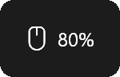
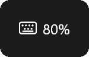
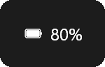
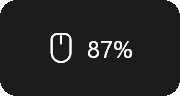
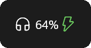

# Wireless Battery

Battery levels of your wireless mouse, keyboard, headset, earbuds and controllers, right on the
Windows taskbar. One small native executable, no vendor software, no installer.

<p align="center">
  <br>
  
</p>

<sub>All images in this README are rendered by the app itself (`--snapshot`, see
[Regenerating the screenshots](#regenerating-the-screenshots)), using the same drawing code as the
taskbar widget.</sub>

## Contents

- [Features](#features)
- [What you see](#what-you-see)
- [Supported devices](#supported-devices)
- [Install](#install)
- [Using it](#using-it)
- [How it works](#how-it-works)
- [Performance](#performance)
- [Limitations](#limitations)
- [Building from source](#building-from-source)
- [Credits](#credits)

## Features

- **Taskbar widget** next to the notification area, with an icon and a percentage per device.
- **Show all devices or only one**, and hide individual devices.
- **Low-battery notification** when a device drops to 20%, once per discharge.
- **Follows Windows**: light/dark taskbar theme, DPI scaling, and comes back by itself if
  Explorer restarts.
- **Pauses while you play**: no device is queried while a game or any other app is full screen.
- **Lightweight**: a single executable of about 500 KB, written in Rust with plain Win32 for the
  UI. No network access, no telemetry.
- **Start with Windows** (optional, from the menu).

## What you see

### Device types

Each device gets its own icon, using the Windows system icon font (Segoe Fluent Icons).

| Headset | Earbuds | Mouse | Keyboard | Controller | Other |
|:---:|:---:|:---:|:---:|:---:|:---:|
|  |  |  |  |  |  |

### States

| State | Looks like | Meaning |
|---|---|---|
| Normal |  | Current level. |
| Low |  | 20% or less, shown in red. A notification is sent once. |
| Charging |  | Charging, with the current level (when the device reports it). |
| Charging, no level |  | Charging, but the device doesn't report a percentage while the cable is in (e.g. AULA F75). |

A device that stops answering (usually because it went to sleep) keeps showing its last known
level, since the battery doesn't change while it sleeps. A device that is disconnected is removed
from the taskbar and listed as "desconectado" in the menu.

### Show only one device

| Dark taskbar | Light taskbar |
|:---:|:---:|
|  |  |

## Supported devices

| Devices | Connection | How the battery is read |
|---|---|---|
| **Logitech** mice and keyboards (e.g. PRO X Superlight 2) | Lightspeed, Unifying or Bolt receiver | Logitech HID++ protocol, features `0x1004`, `0x1000`, `0x1001`, `0x1F20` |
| **Logitech** headsets with their own dongle | USB dongle | HID++ over the dongle |
| **MCHOSE V9 Pro** headset | 2.4 GHz dongle or USB cable (`291D:385D`) | MCHOSE vendor protocol (`0x65` battery request) |
| **AULA F75** keyboard | 2.4 GHz receiver (`3554:FA09`) | AULA receiver protocol (`0x13 0x4A` battery request) |
| **Bluetooth headphones and earbuds** (AirPods, Galaxy Buds, Sony, JBL...) | Classic Bluetooth | The level the device reports to Windows, the same value shown in Settings > Bluetooth |
| **Bluetooth LE** mice, keyboards and controllers (including AULA F75 in BT mode) | Bluetooth LE | Standard GATT Battery Service (`0x180F` / `0x2A19`) |
| **Xbox and XInput-compatible controllers** | Xbox Wireless adapter, Bluetooth or USB | `Windows.Gaming.Input` battery report |
| **DualSense, DualSense Edge, DualShock 4** | USB or Bluetooth | The controller's own input report (10% steps) |
| **SteelSeries, HyperX, Corsair, Audeze, Roccat** and other headsets | USB dongle | [HeadsetControl](#other-headsets-headsetcontrol), optional |

### Tested on real hardware

| Device | Connection | Status |
|---|---|---|
| Logitech PRO X Superlight 2 | Lightspeed receiver | Working |
| AULA F75 | 2.4 GHz receiver | Working |
| Logitech G Pro Wireless (mouse) | Lightspeed receiver | Working (tested in [taskbar-battery](https://github.com/renanleonel/windows-taskbar-battery)) |
| Logitech PRO X Wireless (headset) | USB dongle | Working (tested in [taskbar-battery](https://github.com/renanleonel/windows-taskbar-battery)) |
| Apple AirPods | Classic Bluetooth | Working (tested in [taskbar-battery](https://github.com/renanleonel/windows-taskbar-battery)) |
| MCHOSE V9 Pro | 2.4 GHz dongle | Implemented from the [mchose-hub-native](https://github.com/jmjp/mchose-hub-native) protocol, not yet confirmed here |
| Bluetooth LE devices, Xbox and PlayStation controllers, HeadsetControl headsets | all | Implemented, not yet tested on hardware |
| Machenike G5 Pro | 2.4 GHz dongle / USB cable | **Not supported**, see [Limitations](#limitations) |

### Other headsets (HeadsetControl)

[HeadsetControl](https://github.com/Sapd/HeadsetControl) reads dozens of headsets that use their
own USB dongle. To use it:

1. Download `headsetcontrol-windows-x86_64.exe` from
   [its releases](https://github.com/Sapd/HeadsetControl/releases/latest).
2. Put it **in the same folder as `wireless-battery.exe`**, or anywhere on your `PATH`.
3. Restart Wireless Battery.

It runs hidden every 3 minutes. Headsets that Wireless Battery already reads by itself (Logitech,
MCHOSE) are not listed twice. HeadsetControl is not bundled, and its GPL license does not apply to
this project.

## Install

1. Download **`wireless-battery.exe`** from the [latest release](../../releases/latest).
2. Move it to a permanent folder, for example `%LOCALAPPDATA%\Programs\wireless-battery\`.
3. Run it. The widget appears on the taskbar, to the left of the notification area.

The executable is not code-signed, so Windows SmartScreen may warn on the first run: click
**More info > Run anyway**, or [build it yourself](#building-from-source).

**Requirements:** Windows 11, 64-bit. Windows 10 should work but is untested.

## Using it

Click the widget (left or right button) to open the menu:

- **Device list**: every device found in this session, with its status. Uncheck a device to hide
  it from the taskbar.
- **Mostrar na barra** (show on the taskbar): **all devices**, or **only** one specific device.
  In "only one" mode, the device stays on the taskbar (with "—") even while disconnected.
- **Atualizar agora**: read every device now.
- **Avisos de bateria baixa**: turn the low-battery notification on or off.
- **Iniciar com o Windows**: start with Windows.
- **Sair**: exit.

Hover the widget to see each device's full name and status.

> The menu and tooltip text are currently in Portuguese.

### Command line

```powershell
wireless-battery.exe           # taskbar widget
wireless-battery.exe --demo    # widget with sample readings covering every state
wireless-battery.exe --once    # print the devices found and exit
wireless-battery.exe --hid     # list every HID interface (VID:PID, usage page), for diagnostics
```

Only one instance runs at a time: exit the running widget before starting `--demo`.

## How it works

- **The widget** is a small transparent window attached to the taskbar (`Shell_TrayWnd`) as a
  child window, placed just left of the notification area and drawn with per-pixel alpha, so it
  blends with the taskbar's translucency. The same technique is used by
  [TrafficMonitor](https://github.com/zhongyang219/TrafficMonitor) and
  [taskbar-battery](https://github.com/renanleonel/windows-taskbar-battery).
- **Readings** run on a separate thread, so the menu never freezes while a receiver takes time to
  answer. Each source returns observations, and a small tracker merges them over time (keeping the
  last level of a device that stopped answering, marking vanished devices as disconnected).
- **Vendor protocols** only send read-only battery queries. Nothing is written to the devices'
  configuration.

## Performance

| | |
|---|---|
| Executable | about 500 KB, no installer, no DLLs |
| HID receivers and controllers | read every 60 s |
| Bluetooth and HeadsetControl | read every 3 min (reading wakes the device's radio, and HeadsetControl starts a process) |
| Device plugged in or out, PC resumed from sleep | read immediately |
| Game or app in full screen | **no reads at all**; one check every 10 s to see if it ended, then everything is read at once |
| Network | none |

Each HID read is a few packets of 20 to 64 bytes and takes a few milliseconds. Between reads the
thread is idle.

### Settings stored

| Location | Purpose |
|---|---|
| `HKCU\Software\wireless-battery` (`Display`, `Hidden`, `LowBatteryAlerts`) | Menu choices |
| `HKCU\Software\Microsoft\Windows\CurrentVersion\Run` → `WirelessBattery` | Start with Windows |
| `HKCU\Software\Classes\AppUserModelId\WirelessBattery` | Allows Windows notifications |

## Limitations

- **Taskbar placement** relies on the internal window layout of the Windows 11 taskbar, which is
  not a public API. A Windows update may require an adjustment.
- **Main taskbar only.** Taskbars on secondary monitors are not supported yet.
- **2.4 GHz dongles from other brands** (Razer, SteelSeries and Corsair mice and keyboards,
  Redragon, Attack Shark...) are not supported: each uses its own undocumented protocol. The same
  devices work over Bluetooth when they report their battery there. Headsets from several of these
  brands work through [HeadsetControl](#other-headsets-headsetcontrol).
- **Machenike G5 Pro** (and similar controllers): the 2.4 GHz dongle and the USB cable present the
  controller to Windows as a wired Xbox controller with a fixed "full" battery, unrelated to the
  real level. The app ignores that value, so the controller is not shown on the dongle. Over
  Bluetooth in PC mode it appears as an Xbox controller.
- **AULA**: only the F75 receiver (`3554:FA09`) is recognized. On the USB cable the keyboard reports
  "charging" without a percentage.
- **MCHOSE**: only the V9 Pro protocol is known. Other MCHOSE headsets with the same interface may
  work, but are untested.
- **Sleeping vs. off**: for Logitech and AULA receivers, a device that is switched off looks the
  same as one that is asleep, so it keeps its last level until the receiver is unplugged.
- **Charging state** is not available for Bluetooth devices.
- **PlayStation controllers over Bluetooth** only report their battery after a game or Steam has
  used them once.
- **Windows 10** has no Segoe Fluent Icons font: the app falls back to Segoe MDL2 Assets, and
  earbuds use the headset icon there.
- The menu and notifications are in Portuguese.

## Building from source

Requirements: [Rust](https://rustup.rs) with the **GNU** toolchain. The Visual Studio Build Tools
are not needed.

```powershell
git clone https://github.com/georgepxto/wireless-battery-rust
cd wireless-battery-rust
rustup override set stable-x86_64-pc-windows-gnu
cargo build --release          # -> target\release\wireless-battery.exe
```

Notes:

- The Windows manifest (required for the taskbar child window), the icon and the version info are
  embedded from a precompiled resource object, `res/resources.o`, because the GNU toolchain from
  rustup ships without `windres`. To regenerate it after changing `res/app.rc`,
  `res/app.manifest` or `res/app.ico`:
  `x86_64-w64-mingw32-windres res/app.rc -O coff -o res/resources.o`.
- `hidapi` is pinned to 2.6.4, the last version that doesn't require `dlltool`.

### Regenerating the screenshots

```powershell
cargo run --release --features snapshot -- --snapshot docs\raw
```

This renders every state to transparent PNGs at 2x scale with the same code as the widget. The
`snapshot` feature is not part of release builds.

### Releases

The [Release workflow](.github/workflows/release.yml) builds the executable on Windows and
publishes it. Push a tag (`git tag v0.6.0 && git push origin v0.6.0`) or run the workflow from the
Actions tab with a version.

## Credits

- **[taskbar-battery](https://github.com/renanleonel/windows-taskbar-battery)** by Renan Leonel
  (MIT): the taskbar widget, rendering, notifications, settings, the Logitech HID++, Bluetooth,
  Xbox, PlayStation and HeadsetControl readers come from this project, with adaptations.
- **[mchose-hub-native](https://github.com/jmjp/mchose-hub-native)** by João (jmjp) (MIT): the
  reverse-engineered MCHOSE V9 Pro battery protocol.
- **[sanshoku](https://github.com/ushineko/sanshoku/issues/36)** (MIT) and
  **[Device-Battery-Info](https://github.com/PyFlat/Device-Battery-Info)**: the AULA F75 receiver
  battery protocol and captured frames.
- **[Machenike-G2-Pro-V2-PC](https://github.com/Kozato01/Machenike-G2-Pro-V2-PC)** by Kozato01: the
  research showing that the Machenike dongle exposes no battery information.
- **[Solaar](https://github.com/pwr-Solaar/Solaar)**: the reference for Logitech's HID++ protocol.
- **[HeadsetControl](https://github.com/Sapd/HeadsetControl)** (GPL, optional external program):
  headset support for many brands.
- **[TrafficMonitor](https://github.com/zhongyang219/TrafficMonitor)**: the taskbar child-window
  technique.
- **[Wireless-Device-Battery-Monitor](https://github.com/krisgfx9/Wireless-Device-Battery-Monitor)**
  by krisgfx9: the inspiration behind taskbar-battery, and a broader tool if your device isn't
  supported here.

Full license texts of the third-party code are in [THIRD-PARTY-NOTICES.md](THIRD-PARTY-NOTICES.md).

This project is not affiliated with or endorsed by Logitech, MCHOSE, AULA, Machenike, Sony,
Microsoft, Apple or any other brand mentioned. All trademarks belong to their owners.
